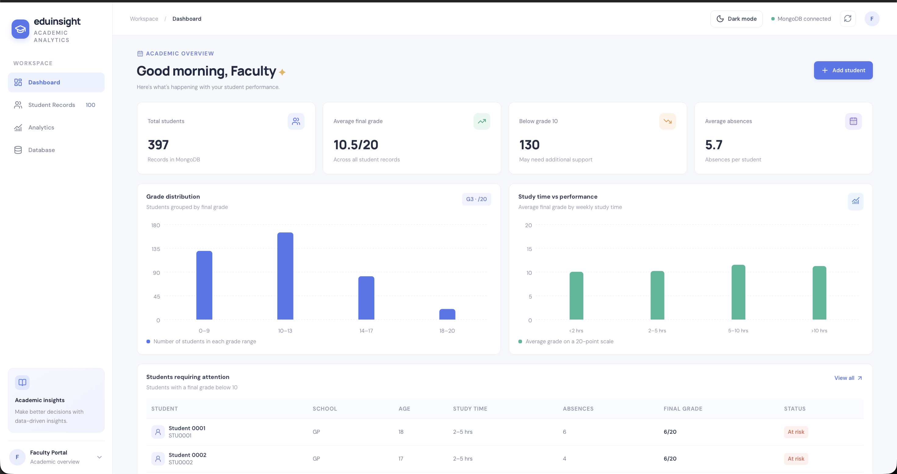
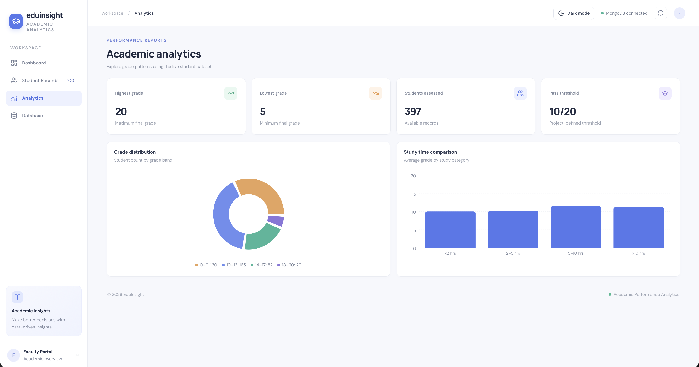
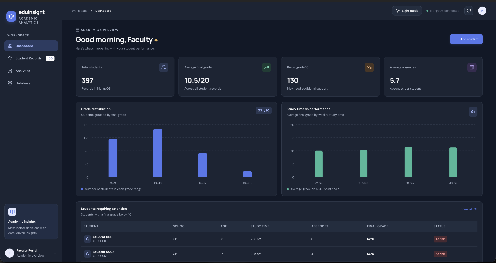
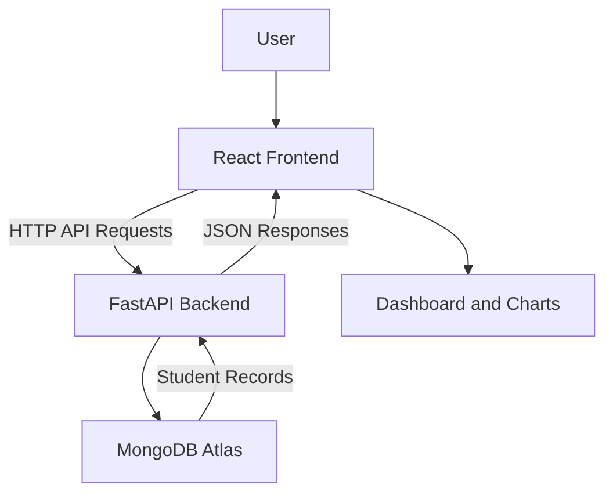

# EduInsight — Student Performance Analytics

EduInsight is a student performance analytics dashboard built to explore academic records, identify students who may need additional support, and visualize educational data through an interactive web interface.

## Screenshots

### Dashboard


### Analytics


### Dark Mode


## Features

- **Dashboard:** View total students, average final grade, average absences, and students at risk.
- **Student Records:** Browse student information in a searchable, filterable table.
- **Student Management:** Add student records and delete eligible records.
- **Data Visualization:** Explore grade distributions and study-time performance using charts.
- **Analytics:** View aggregated academic performance insights.
- **CSV Export:** Export student records for further analysis.
- **Light and Dark Modes:** Switch between visual themes.
- **Database Status:** Check the backend's database connection status.

## Technology Stack

| Component | Technology |
|---|---|
| Frontend | React, Vite, JavaScript |
| Charts | Recharts |
| Icons | Lucide React |
| Backend | Python, FastAPI |
| Database | MongoDB Atlas |
| Data Source | UCI Student Performance Dataset |

## Architecture



The React frontend communicates with the FastAPI backend through REST API endpoints. The backend reads and updates student records in MongoDB Atlas and returns JSON responses to the frontend.

## Project Structure

```text
eduinsight/
├── backend/
│   ├── main.py
│   ├── import_data.py
│   └── .env.example
├── frontend/
│   ├── src/
│   ├── public/
│   ├── package.json
│   └── index.html
├── screenshots/
│   ├── dashboard.png
│   ├── analytics.png
│   └── dark-mode.png
├── student-mat.csv
├── .gitignore
├── README.md
└── LICENSE
```

*The structure above describes the intended layout; adjust filenames if your repository differs.*

## Requirements

- Python 3.12 or another version compatible with the backend dependencies
- Node.js and npm
- A MongoDB Atlas account or a compatible MongoDB deployment
- Git

## Setup and Installation

### 1. Clone the repository

```bash
git clone https://github.com/theskymishra/EduInsight.git
cd EduInsight
```

### 2. Configure the backend

```bash
cd backend
python3 -m venv .venv
source .venv/bin/activate
pip install -r requirements.txt
```

Create a `.env` file inside `backend/` containing your MongoDB connection string:

```env
MONGODB_URI=your_mongodb_atlas_connection_string
```

Replace the placeholder with your own connection string. Never commit `.env` or publish database credentials.

Start the backend:

```bash
uvicorn main:app --reload --port 8000
```

Backend API documentation is available at:

`http://localhost:8000/docs`

### 3. Configure the frontend

Open a second Terminal window:

```bash
cd EduInsight/frontend
npm install
npm run dev
```

Open the local URL printed by Vite, usually:

`http://localhost:5173`

### 4. Database and dataset

EduInsight uses the MongoDB database `eduinsight` and the `students` collection.

The project dataset is based on the UCI Student Performance Dataset. Configure MongoDB before importing data. Run the provided import script only when needed and after checking whether the records have already been imported.

## API Endpoints

| Method | Endpoint | Purpose |
|---|---|---|
| GET | `/api/health` | Check database connectivity |
| GET | `/api/dashboard` | Retrieve dashboard statistics |
| GET | `/api/students` | Retrieve and filter student records |
| POST | `/api/students` | Add a student record |
| DELETE | `/api/students/{student_id}` | Delete an eligible student record |
| GET | `/api/analytics` | Retrieve analytics data |

## Dataset Attribution

The project uses the **Student Performance** dataset from the UCI Machine Learning Repository.

- Dataset page: https://archive.ics.uci.edu/dataset/320/student+performance
- Authors: Paulo Cortez and Alice Silva
- Publication: *Using Data Mining to Predict Secondary School Student Performance* (2008)

Please consult the original dataset page and its licensing terms when redistributing the dataset.

## Security Notes

- Store database credentials in `backend/.env`.
- Keep `.env`, virtual environments, and `node_modules/` out of version control.
- Use your own MongoDB Atlas connection string when setting up the project.

## Author

**Akash Mishra**

GitHub: https://github.com/theskymishra

## License

This project is distributed under the MIT License. See [LICENSE](LICENSE) for details.